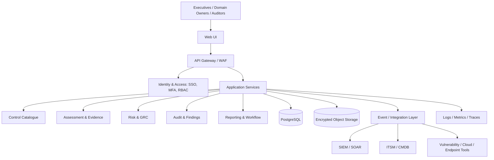

# Enterprise Architecture

## Architecture principles
Business capability alignment; domain-driven modularity; API-first integration; secure-by-design; data ownership; interoperability; observable operations; resilience; portability; and controlled technical debt.

## Logical architecture

## Recommended technology baseline
- Frontend: TypeScript + React (or retain current HTML prototype for pilot).
- API: Python FastAPI or equivalent typed REST service.
- Primary data: PostgreSQL; object storage for evidence; optional search index for large catalogues.
- Identity: enterprise OIDC/SAML identity provider; MFA; SCIM lifecycle provisioning.
- Integration: REST/webhooks and message queue for asynchronous connector events.
- Hosting: organization-approved cloud or on-premises platform with private networking.

## Domain boundaries
- Strategy & leadership: CIO, CTO, CISO and cross-functional controls.
- Architecture: enterprise architecture and security architecture.
- Assurance: IT audit, GRC and security/compliance.
- Technical posture: infrastructure and system hardening.
- Shared platform: identity, workflow, evidence, reporting, audit log and integration.

## Data ownership
Control owners attest to implementation; risk owners accept residual risk; compliance owners interpret obligations; internal audit independently evaluates assurance. Platform administrators must not silently alter assessment evidence or audit records.

## Environments
Separate development, test, staging and production. Use infrastructure as code, isolated credentials, synthetic test data and controlled release approvals.
